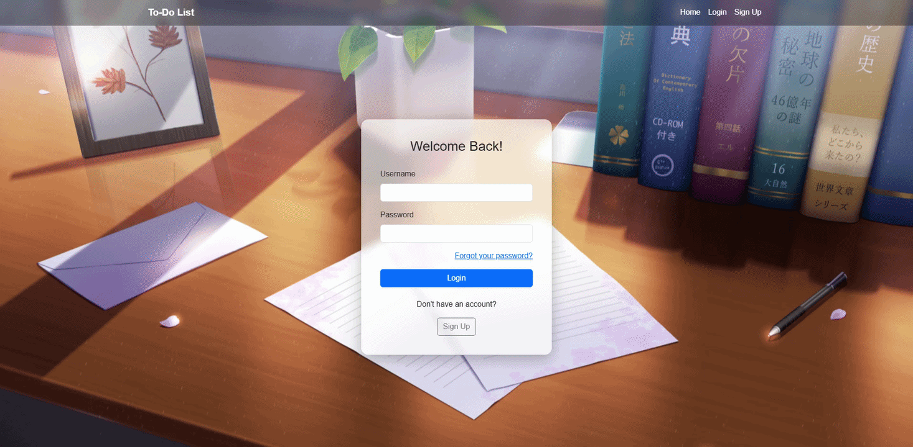

# To-Do List Website

**A Python Flask website to keep track of daily activities.**



## Project Structure
- `forms.py` — Manages user input forms.
- `models.py` — Defines the database tables (User, Task, Recovery).
- `email_sender.py` — Sends recovery emails.
- `extensions.py` — Initializes the db, bcrypt and login_manager objects.
- `main.py` — Manages routes and Flask configuration.

## Features
- Create an account, log in, and log out.
- Add, mark as done, and delete tasks.
- Delete all tasks at once.
- Recover a forgotten password using a 6-character code sent to your email.
- Recovery codes expire after 10 minutes.
- All users and tasks are stored in a database; passwords are saved as bcrypt hashes.
- Displays the current date on the tasks page.

## Technologies
- Python 3.13
- Flask
- Flask-Bcrypt
- Flask-Login
- Flask-SQLAlchemy
- Flask-WTF
- `os`, `smtplib`, `random`, `string`, `datetime` and `time` modules

## Concepts Practiced
- Template Inheritance
- Flask-WTF forms with CSRF protection
- Jinja macros
- Relational Database
- Connecting Flask to a database
- Sending email with `smtplib`

## Credits
- The static visual design (HTML/CSS) was generated with AI and adapted for this project.
- All Python/Flask code, Jinja templating, and form integration are my own work.

## Configuration
The app reads these environment variables at startup:

| Variable     | Purpose                                  |
|--------------|------------------------------------------|
| `SECRET_KEY` | Signs sessions and CSRF tokens           |
| `SMTP_USER`  | Gmail address that sends recovery codes  |
| `SMTP_PASS`  | Gmail app password for that account      |

Generate a secret key with:
```bash
python -c "import secrets; print(secrets.token_hex())"
```

## How to Run
Install the required packages:
```bash
pip install -r requirements.txt
```
Then run the program:
```bash
python main.py
```